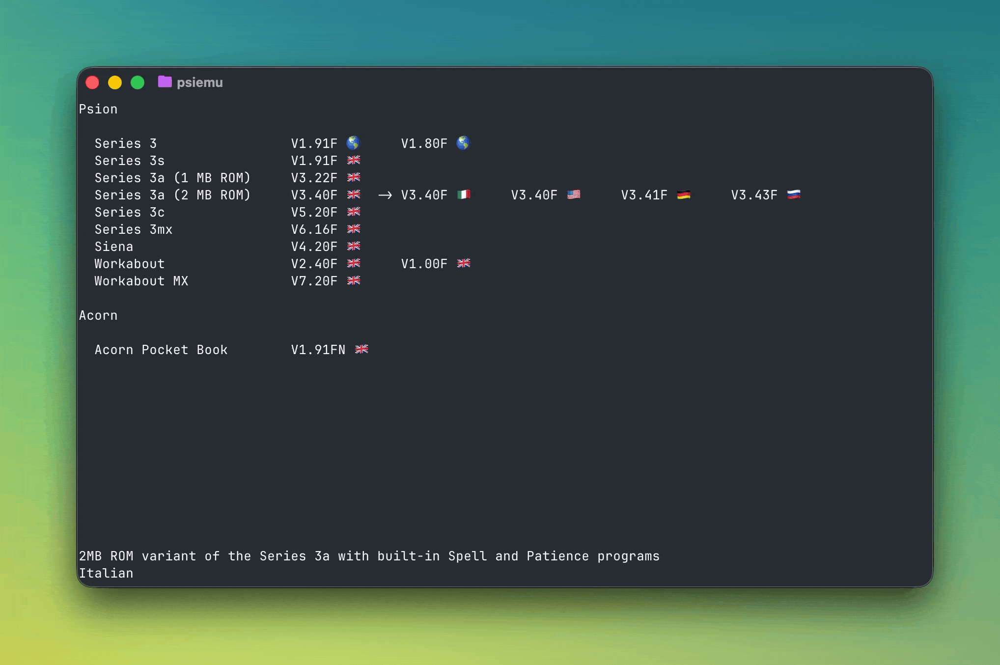

# PsiEmu

Lightweight TUI launcher for Psion MAME emulators.



## Installation

PsiEmu is available on PyPI. One of the easiest ways to install it is using [uv](https://docs.astral.sh/uv/):

```sh
uv tool install psiemu
```

Check for updates:

```sh
uv tool upgrade psiemu
```

## Development

### Clone

```sh
git clone ssh://git@codeberg.org/psion/psiemu.git
```

### Dependencies

PsiEmu includes a `Pipfile` for local development. Install using `pipenv` as follows:

```sh
pipenv install
```

### Running

The top level executable bash script automatically runs the local source using `pipenv`:
  
```sh
./psiemu
```

### MAME

Print specific details of MAME systems using `-listroms` and `-listbios`.

- Show different machine configurations:

  ```sh
  mame psion3mx_fr -listbios
  ```

  ```plaintext
  BIOS options for system Series 3mx (French) (psion3mx_fr):
      620f             V6.20F/FRE
  ```

- Show ROM details:

  ```sh
  mame psion3mx_fr -listroms
  ```

  ```plaintext
  ROMs required for driver "psion3mx_fr".
  Name                                   Size Checksum
  maple_v6.20f_fre.bin                2097152 CRC(b4fc57f4) SHA1(26588937d811adf08b973a0188927707d1f6a6e4)
  ```
  
- Get all the Psion-specific device details in a structured form:
  ```sh
  mame -listxml "psion*"
  ```

